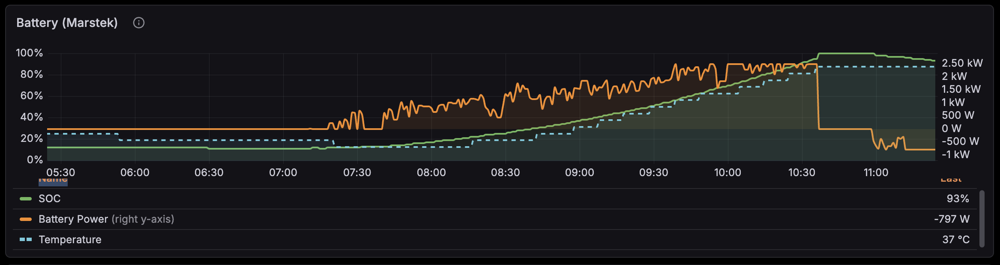

# Prometheus Marstek Exporter

A Prometheus exporter for [Marstek](https://eu.marstekenergy.com/) home battery systems. Collects metrics from Marstek batteries over local LAN using the [go-marstek](https://github.com/loafoe/go-marstek) client library.

## Metrics

| Metric | Type | Description |
|--------|------|-------------|
| `marstek_battery_soc_percent` | Gauge | Battery state of charge (0-100%) |
| `marstek_battery_temperature_celsius` | Gauge | Battery temperature |
| `marstek_battery_capacity_wh` | Gauge | Current battery capacity |
| `marstek_battery_rated_capacity_wh` | Gauge | Rated battery capacity |
| `marstek_battery_charging` | Gauge | Charging state (1=charging) |
| `marstek_battery_discharging` | Gauge | Discharging state (1=discharging) |
| `marstek_battery_power_watts` | Gauge | Battery power (positive=charging) |
| `marstek_pv_power_watts` | Gauge | Solar power by input |
| `marstek_pv_voltage_volts` | Gauge | Solar voltage by input |
| `marstek_pv_current_amps` | Gauge | Solar current by input |
| `marstek_grid_power_watts` | Gauge | Grid power (positive=import) |
| `marstek_offgrid_power_watts` | Gauge | Offgrid load power |
| `marstek_phase_power_watts` | Gauge | Per-phase power (A, B, C) |
| `marstek_total_power_watts` | Gauge | Total system power |
| `marstek_ct_clamp_connected` | Gauge | CT clamp state |
| `marstek_pv_energy_kwh_total` | Counter | Cumulative solar energy |
| `marstek_grid_input_energy_kwh_total` | Counter | Cumulative grid import |
| `marstek_grid_output_energy_kwh_total` | Counter | Cumulative grid export |
| `marstek_load_energy_kwh_total` | Counter | Cumulative load consumption |
| `marstek_operating_mode` | Gauge | Current mode (Auto, AI, Manual, Passive, Ups) |

## Example Dashboard



Import the dashboard from [resources/grafana-marstek.json](resources/grafana-marstek.json).

## Installation

### Docker

```bash
docker run -d --name marstek-exporter \
  -p 9141:9141 \
  -e MARSTEK_DEVICE_IPS=192.168.1.100 \
  ghcr.io/loafoe/prometheus-marstek-exporter:latest
```

### From Source

```bash
go install github.com/loafoe/prometheus-marstek-exporter@latest
```

## Usage

```bash
prometheus-marstek-exporter -device-ips 192.168.1.100
```

### Flags

| Flag | Default | Description |
|------|---------|-------------|
| `-listen-address` | `:9141` | Address to listen on |
| `-device-ips` | (auto-discover) | Comma-separated list of device IPs |
| `-device-port` | `30000` | Marstek UDP port |
| `-timeout` | `10s` | Request timeout |
| `-instance-id` | `0` | Device instance ID |
| `-metrics-path` | `/metrics` | Metrics endpoint |
| `-auto-discover` | `true` | Auto-discover devices on LAN if IPs not specified, also used to recover devices that were assigned a new IP address |
| `-discover-timeout` | `5s` | Discovery timeout |
| `-enable-pv` | `false` | Enable PV (solar) status polling |
| `-max-consecutive-timeouts` | `10` | Consecutive failed calls on a device address before the address is considered stale (0 disables the check) |
| `-exit-on-unreachable` | `true` | Exit the exporter when a device is unreachable and cannot be recovered by rediscovering it |

### Environment Variables

| Variable | Description |
|----------|-------------|
| `MARSTEK_DEVICE_IPS` | Comma-separated device IPs |
| `MARSTEK_DEVICE_PORT` | Device UDP port |
| `MARSTEK_INSTANCE_ID` | Device instance ID |
| `LISTEN_ADDRESS` | Listen address |
| `MARSTEK_ENABLE_PV` | Enable PV polling |

## Recovering From An Address Change

A Marstek device that is connected to WiFi can be assigned a new IP address by
the DHCP server, for example after a router restart. The exporter keeps track
of the failures per device address and treats an address as stale once
`-max-consecutive-timeouts` (10 by default) calls in a row failed with a
timeout or an unreachable host. The streak is reset as soon as the device
answers again.

When the threshold is exceeded the exporter looks the device up on the LAN
again:

- The device is found at a different address. It is matched by its WiFi MAC
  (which does not change) or, if the MAC is unknown, because it is the only
  device on the LAN. The exporter switches over to the new address, rebuilds
  the client and polls all endpoints right away. The metrics then carry the new
  `device_ip` label.
- The device cannot be found, does not report an address or does not answer
  API calls at its new address. The device is reported as unreachable and the
  exporter exits, so that a service manager can restart it and rediscover all
  devices from scratch.

Set `-exit-on-unreachable=false` to keep the exporter running and serving the
last known values instead of exiting, and `-auto-discover=false` to disable the
rediscovery entirely.

## Multiple Devices

The exporter supports multiple batteries on the same LAN. By default, it auto-discovers all Marstek devices. You can also specify devices manually:

```bash
prometheus-marstek-exporter -device-ips 192.168.1.100,192.168.1.101
```

All metrics include `device_ip` and `device_name` labels to distinguish between devices.

## Prometheus Configuration

```yaml
scrape_configs:
  - job_name: 'marstek'
    static_configs:
      - targets: ['localhost:9141']
    scrape_interval: 30s
```

## Disclaimer

This project is not affiliated with, endorsed by, or connected to Marstek in any way. This is an independent, community-developed exporter based on publicly available API documentation.

**USE AT YOUR OWN RISK.** This software interacts with battery hardware and energy systems. Improper use could potentially affect your battery system's operation. The authors and contributors are not responsible for any damage, data loss, or other issues that may arise from using this software. Always ensure you understand the commands you are sending to your device.

## License

Apache License 2.0 - see [LICENSE](LICENSE) for details.
